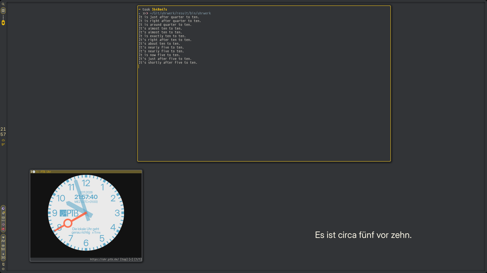

# Clckwrd (formerly `uhrwerk`) is a little cli tool to print 'time in words'.

It is inspired by [TickeTack](http://ticketack.de/) and actually the language strings for German and English are currently taken directly from their website.


*Note: the [PTB Clock](httpsr//uhr.ptb.de) is just for reference, the desktop widget is a (yet to publish) widget for [Noctalia](https://noctaila.dev) which is the desktopshell used here together with their wonderful compositor `umbriel`.*

## Installation

### With Cargo

```sh
git clone https://github.com/VuiMuich/clckwrd
cd clckwrd
cargo install --path .
```

`cargo install` only installs the binary. The language templates are **not** installed automatically, so copy them manually:

```sh
mkdir -p ~/.config/clckwrd/templates
cp time-in-words-templates/*.ron ~/.config/clckwrd/templates/
```

If you'd rather keep them in sync with the repository, symlink the directory instead:

```sh
mkdir -p ~/.config/clckwrd
ln -s "$PWD/time-in-words-templates" ~/.config/clckwrd/templates
```

Without installed templates, `clckwrd` falls back to the built-in English template. Selecting a template by name (`-t de_1`) fails with "template 'de_1.ron' not found in config dir" if it's missing.

You can also skip the config directory and load a template file directly:

```sh
clckwrd --path ./time-in-words-templates/de_1.ron
```

### With Nix

The flake installs the templates to `$out/share/clckwrd/templates`.

## Faking the time

To test a template or check how a specific time is worded, pass a fixed time with `-i`/`--input` in `HH:MM` (24-hour) format. `clckwrd` prints the result once and exits instead of running its update loop.

```sh
clckwrd -i 12:57              # It's about five to one.
clckwrd -i 08:30 -t de_1      # Es ist jetzt halb neun.
clckwrd -i 23:58 --combined   # digital and words together
```

Good times to check when writing or changing a template:

| Time | Why |
|---|---|
| `xx:57`, `xx:58` | rounding to the next slot, hour rollover |
| `xx:27`, `xx:28` | slot boundary around the half hour |
| `xx:32`, `xx:33` | switch to the next hour (`next_hour_from`) |
| `12:00`, `00:00` | twelve / midnight handling |
